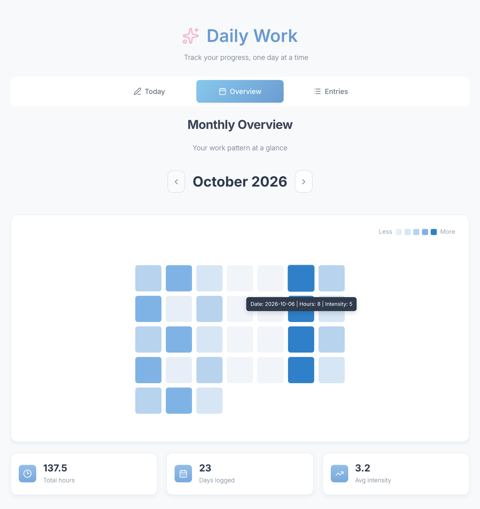
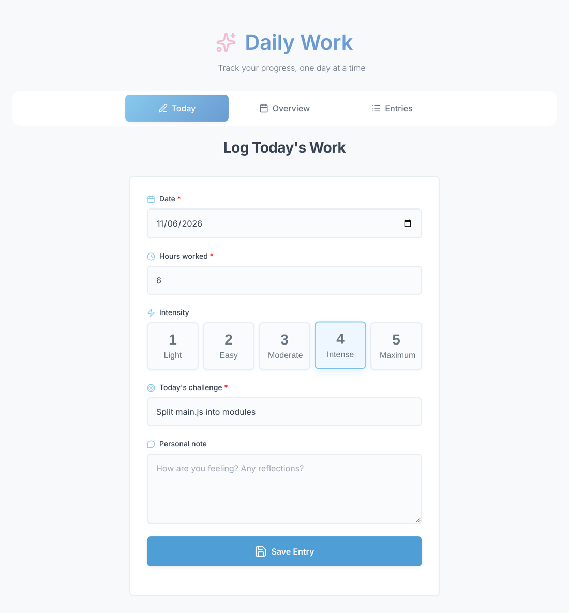
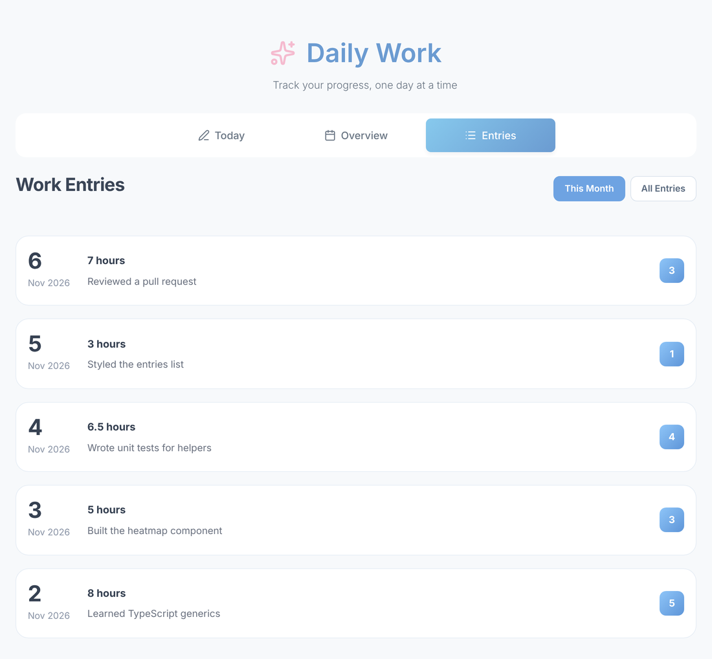

# Daily Work

A small productivity tracker for logging how much you worked each day, how intense the day was and what the main challenge was. A monthly heatmap shows your work pattern at a glance.

Built with **vanilla JavaScript (ES modules), HTML and CSS**, with no frameworks and no build step.

> This is the first of three versions of the same app:
> **daily-work** (vanilla JS) → [daily-work-ts](https://github.com/tijana333/daily-work-ts) (TypeScript) → [daily-work-react](https://github.com/tijana333/daily-work-react) (React)

<p align="center">
  
</p>

## Features

- **Log a day:** date, hours worked, intensity (1–5), today's challenge and an optional personal note
- **Edit automatically:** picking a date that already has an entry loads it into the form and saves changes as an update
- **Validation:** required fields, hours between 0 and 24, no future dates, length limits
- **Monthly overview:** heatmap colored by intensity, hover tooltips, total hours, days logged and average intensity
- **Month navigation:** arrow buttons, or swipe left/right on mobile
- **Entries list:** this month or all entries, newest first
- **Entry details:** view, edit or delete an entry in a modal (closes with Esc or a click outside)
- Loading, empty and error states for every request

## Screenshots

| Log today's work | Entries |
| --- | --- |
|  |  |

## Tech stack

- HTML5, CSS3 (flexbox, grid, media queries)
- JavaScript (ES modules, `fetch`, `async`/`await`)
- [Lucide](https://lucide.dev/) icons, Google Fonts (Inter, Space Grotesk)
- REST API backend hosted on Vercel

## Getting started

The app uses ES modules, so it has to be served over HTTP. Opening `index.html` directly as a file will not work.

```bash
git clone https://github.com/tijana333/daily-work.git
cd daily-work
```

Then start any static server in the project folder, for example:

- **VS Code:** right-click `index.html` → *Open with Live Server*
- **Node:** `npx serve .`
- **Python:** `python -m http.server 8080`

and open the address it prints in the browser.

## Project structure

```
daily-work/
├── index.html            # Markup for all three tabs and the modal
├── style.css             # All styles
└── js/
    ├── main.js           # Entry point: connects the features
    ├── api/
    │   └── entriesApi.js # All requests to the backend
    ├── features/
    │   ├── tabs.js       # Tab switching
    │   ├── form.js       # "Today" form: create / update entries
    │   ├── entries.js    # Entries list and delete
    │   ├── modal.js      # Entry details modal
    │   └── heatmap.js    # Monthly heatmap, stats, month navigation
    └── utils/
        ├── validators.js # Form validation
        └── helpers.js    # HTML escaping, local date helpers
```

## API

All requests go through `js/api/entriesApi.js`.

| Method | Endpoint | Description |
| --- | --- | --- |
| `GET` | `/api/entries` | All entries |
| `GET` | `/api/entries?month=11&year=2026` | Entries for one month |
| `GET` | `/api/entries?date=2026-11-06` | Entry for one date |
| `POST` | `/api/entries` | Create an entry (`409` if the date already has one) |
| `PUT` | `/api/entries/:id` | Update an entry |
| `DELETE` | `/api/entries/:id` | Delete an entry |

An entry looks like this:

```json
{
  "date": "2026-11-06",
  "hours": 6,
  "intensity": 4,
  "challenge": "Split main.js into modules",
  "note": "Optional personal note"
}
```

## Workflow

Each task was developed on its own branch named after the task (`DW-18`, `DW-30`, …) and merged into `main` through a pull request.

## Author

**Tijana Đuknić**
[GitHub](https://github.com/tijana333) · [LinkedIn](https://www.linkedin.com/in/tijana-%C4%91ukni%C4%87-2175822b8/)
